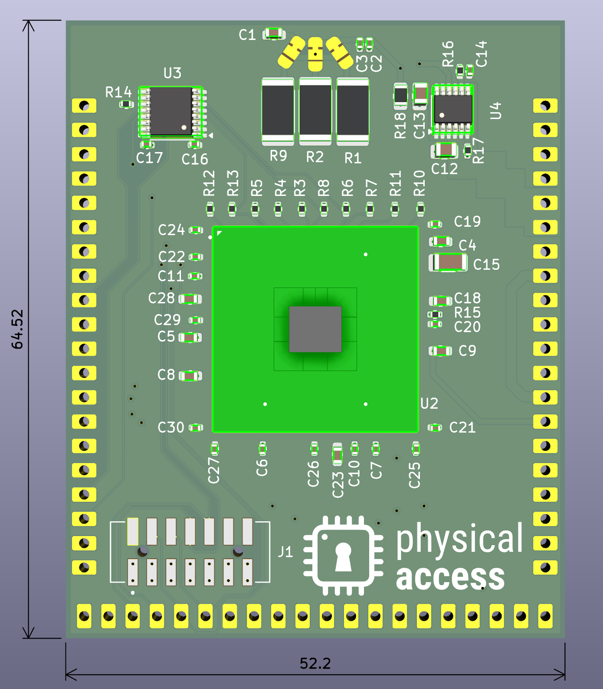

Requires JTAG programmer or flash connected to HDS pins to be programmed.
I am using a flash emulator on HDS, i.e. Dediprog EM100.
However, JTAG works equally well.

# Errata and plans for Rev-2:
- Use a different DC supply for VCC INT. This one provides up to 500mA. The chip can draw >500mA is specific scenarios w.r.t. the datasheet.
- Replace the three parallel shunts with my current transformer design
- Connect the SBI signals to the CW308 header, such that chipwhisperer can program (after updating chipwhisperer python, it is currently not supported)

